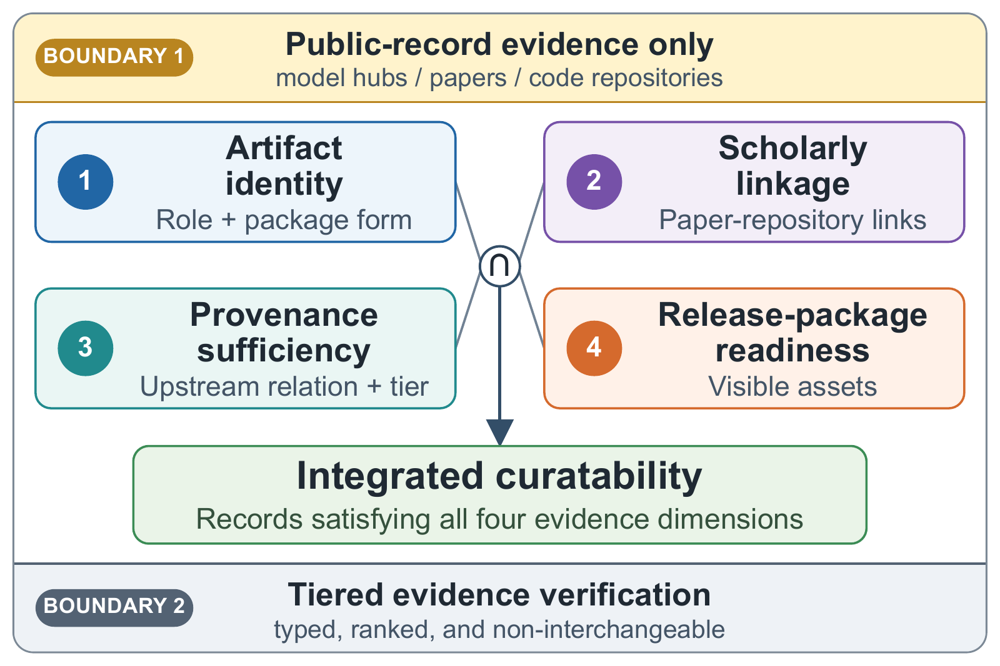
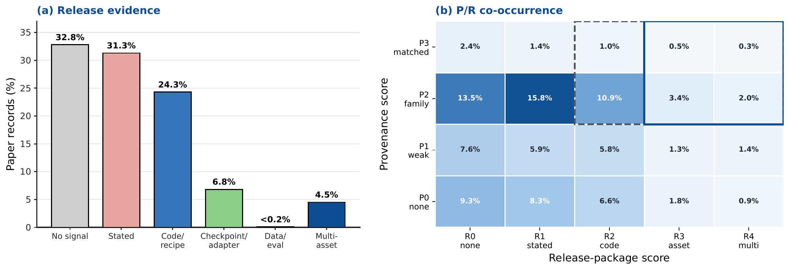

<div align="center">

# Visible but Not Yet Curatable

### Characterizing the Curatability of<br>Compact and Derived Open LLM Artifacts

**ACM/IEEE JCDL 2026**

**Yiyi Lu · Yilai Qian · Yucheng Jin**<br>
Duke Kunshan University

[](https://doi.org/10.1145/3805696.3846021)
[](LICENSE)
[](docs/REPRODUCIBILITY.md)

**[Paper](https://doi.org/10.1145/3805696.3846021)** · **[Findings](#from-visibility-to-curatability)** · **[Data](#explore-the-study)** · **[Quickstart](#quickstart)** · **[Citation](#citation)**

</div>

---

**An open model can be easy to find and still difficult to identify, cite, and preserve. What evidence makes it curatable?**

We study compact and derived open LLM artifacts through the public records surrounding them: papers, model hubs, model cards, code repositories, and release statements. Our framework connects four evidence dimensions into a **record-level measure of curatability** and a **minimal seven-field metadata record** for digital libraries.

| Repository snapshot | Main analysis | Expert audits |
| :---: | :---: | :---: |
| **191,375** Hugging Face repository records | **2,214** scholarly paper records | **300** role / **200** upstream / **50** release |
| Scoped May 2026 snapshot | Paper-record evidence and thresholds | Calibration of evidence decisions |

<p align="center">
  
</p>

## From Visibility to Curatability

Public signals are widespread; coordinated evidence is much rarer.

| Curation threshold | Paper records | Share |
| :--- | ---: | ---: |
| Discovery-ready: at least one useful evidence signal | 2,008 | **90.7%** |
| Operational: usable upstream evidence and concrete release evidence | 401 | **18.1%** |
| High curatability: usable upstream evidence, asset-level release, and direct linkage | 136 | **6.1%** |

These are nested thresholds over the **same 2,214 paper records**. Their definitions and the underlying scores are documented in the [coding guide](docs/CODING_GUIDE.md) and [paper-level table](data/main_analysis/jcdl_paper_curatability_paper_level.csv).

<p align="center">
  
</p>

**The bottleneck is evidence coordination.** Code, upstream references, model weights, and scholarly links answer different questions. The release distribution and provenance-release cross-tabulation show why a visible artifact does not automatically form a curatable scholarly record.

In the heatmap, the dashed outline marks operational P+R; the solid outline marks its asset-level subset. High curatability also requires direct scholarly linkage (`L >= 1`).

The paper translates these findings into seven metadata fields: `artifact_role`, `package_form`, `paper_repository_relation`, `upstream_relation_type`, `provenance_evidence_tier`, `release_asset_types`, and `license_access_signal`.

## Explore the Study

| I want to... | Start here |
| :--- | :--- |
| Inspect repository metadata coverage and inferred roles | [Repository-level records](data/main_analysis/jcdl_metadata_completeness_repo_level.csv) |
| Explore paper-level evidence and curation thresholds | [Paper-level records](data/main_analysis/jcdl_paper_curatability_paper_level.csv) · [Threshold sensitivity](data/main_analysis/jcdl_curatability_threshold_sensitivity.csv) |
| Trace paper-to-repository alignment | [Alignment edges](data/main_analysis/jcdl_paper_repo_alignment_edges.csv) · [Signal decomposition](data/main_analysis/jcdl_paper_repo_alignment_decomposition.csv) |
| Examine audit results and schema examples | [Audit intervals](data/validity_checks/audit_wilson_ci.csv) · [Schema walkthroughs](data/validity_checks/curator_schema_review_cases_10.csv) |
| Understand the evidence codes and denominators | [Coding guide](docs/CODING_GUIDE.md) · [Data dictionary](docs/DATA_DICTIONARY.md) |
| Connect the findings to metadata design | [Recommendation crosswalk](data/main_analysis/jcdl_metadata_recommendation_crosswalk.csv) |
| Generate analysis figures and LaTeX tables | [Analysis workflow](docs/REPRODUCIBILITY.md) |

The [data index](data/README.md) organizes the complete collection by analysis purpose. Repository coverage uses the scoped snapshot; paper-level results use the main-analysis records; audit rates use the corresponding audit samples.

## Quickstart

Use **Python 3.10+**. The integrity check uses the standard library. Figure and table generation uses pandas, NumPy, and Matplotlib.

```bash
git clone https://github.com/AndyLu666/VNYC-Open_Source_LLM_Study.git
cd VNYC-Open_Source_LLM_Study

python3 scripts/verify_artifact.py

python3 -m venv .venv
source .venv/bin/activate
python -m pip install -r requirements.txt
python scripts/make_figures_tables.py
```

The analysis runs locally on the provided CSV tables. Outputs go to `paper/figures/` (PDF and PNG) and `paper/tables/` (LaTeX), with additional table exports in `paper/tables/supplementary/`. See the [workflow guide](docs/REPRODUCIBILITY.md) for the output map and a short example for recomputing the headline counts.

## Repository Map

```text
VNYC-Open_Source_LLM_Study/
  assets/readme/          Paper figures displayed on this page
  data/
    main_analysis/       Repository records, paper records, summaries, and links
    validity_checks/     Audit intervals, threshold rationale, and curated cases
    sensitivity_checks/ Query-bucket sensitivity analysis
    audit_support/      Repository-role audit summaries
  docs/                  Data dictionary, coding guide, and analysis workflow
  scripts/               Integrity checks and figure/table generation
  tests/                 Integrity-check regression tests
  CITATION.cff           Machine-readable paper citation
  MANIFEST.csv           Released-file inventory and checksums
  LICENSE                MIT license for original code and documentation
  THIRD_PARTY_NOTICES.md  Source attribution and licensing scope
```

## Citation

```bibtex
@inproceedings{lu2026curatability,
  author    = {Lu, Yiyi and Qian, Yilai and Jin, Yucheng},
  title     = {Visible but Not Yet Curatable: Characterizing the Curatability of Compact and Derived Open LLM Artifacts},
  booktitle = {The 2026 ACM/IEEE Joint Conference on Digital Libraries},
  series    = {JCDL '26},
  year      = {2026},
  publisher = {Association for Computing Machinery},
  doi       = {10.1145/3805696.3846021},
  url       = {https://doi.org/10.1145/3805696.3846021}
}
```

Yiyi Lu and Yilai Qian contributed equally. Corresponding author: **Yucheng Jin**, [yj232@duke.edu](mailto:yj232@duke.edu). Citation metadata are also available in [CITATION.cff](CITATION.cff).

## License and Attribution

Original project code, documentation, and author-created analysis annotations and aggregations are released under the **[MIT License](LICENSE)**. Paper figures are shared under **[CC BY 4.0](https://creativecommons.org/licenses/by/4.0/)**, with attribution in the [figure index](assets/readme/README.md). Source metadata and linked third-party artifacts retain their original terms; see [THIRD_PARTY_NOTICES.md](THIRD_PARTY_NOTICES.md).

We thank the research communities maintaining open model repositories and scholarly metadata, and the [figures4papers](https://github.com/ChenLiu-1996/figures4papers) project for visualization inspiration.

For questions about the data or analysis, please [open an issue](https://github.com/AndyLu666/VNYC-Open_Source_LLM_Study/issues).
